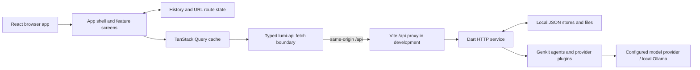

# Lumi React — Architecture and Codebase Review

**Review date:** 2026-10-20  
**Scope:** React web client in this repository, plus the Dart/Genkit service it calls in the sibling `Learning-App` repository.  
**Method:** Static inspection of source, package/build configuration, scripts, and the project notes in `README.md`, `PROJECT_PLAN.md`, and `BACKEND.md`. This report describes the checked-in implementation; it does not claim a new build or test run.

## Executive summary

Lumi React is a single-page browser client built with React 19, TypeScript, Vite, and TanStack Query. It is not a standalone full-stack JavaScript application: the browser delegates durable workspace operations and AI work to an existing Dart HTTP service that integrates Genkit and configured model providers. During local development the browser calls `/api` through Vite's proxy; the Dart service is the authority for workspace data, settings, provider credentials, agent tools, and persisted conversations/artifacts.

The code already follows several sound architectural boundaries: feature-oriented UI files, a central typed API module, React Query for remote state, URL/history-backed navigation, local component state for transient interaction, and a backend that separates HTTP/API orchestration from collection stores and Genkit agents. The main structural inconsistency is that `PROJECT_PLAN.md` describes an intended `src/app` composition area, while the current implementation keeps the main application shell and composition in `src/App.tsx`. `App.tsx` is also a substantial orchestration component that owns navigation, shell UI, folder operations, theme application, and screen composition. This is the clearest future modularization seam; it does not invalidate the existing state/API boundaries.

## Stack at a glance

| Area | Implemented technology / responsibility |
|---|---|
| Browser UI | React 19, React DOM, TypeScript 6 |
| Development/build | Vite 8, `@vitejs/plugin-react`, TypeScript project build (`tsc -b`) |
| Remote/server state | TanStack Query 5 (`QueryClient`, query/mutation hooks, cache updates and invalidation) |
| Navigation | Small custom history API hook; path identifies workspace view, query parameters identify selected note/folder or settings section |
| Styling | Hand-authored global CSS in `src/index.css` and `src/App.css`, including CSS custom properties and root data attributes for theme/accent/density; no CSS framework is configured |
| Icons and rich content | `lucide-react`; KaTeX for math, loaded on demand by the Markdown preview |
| HTTP client | Typed wrappers around browser `fetch` in `src/lib/lumi-api.ts`; JSON endpoints plus streamed SSE for Coach responses |
| Backend | Dart command-line HTTP service in sibling `Learning-App/bin/server.dart`; Genkit Dart agents and provider plugins |
| Persistence | Local JSON collections and attachment/session files beneath backend `.data` by default, configurable with `LUMI_DATA_DIR`; no SQL database in this architecture |
| Checks/tooling | Oxlint, Vitest + Testing Library + jsdom, production TypeScript/Vite build, dedicated Chrome E2E runner |

The design canvas referenced by the README is a visual/design reference. Runtime UI is implemented in local React/CSS source, with no runtime CDN requirement.

## Repository layout and responsibility

```text
Learning-App-React/
├── index.html                       # Vite HTML document and React mount point
├── src/
│   ├── main.tsx                     # React root, StrictMode, QueryClientProvider
│   ├── App.tsx                      # Workspace shell, app-level queries/mutations, composition
│   ├── App.css                      # Workspace and feature styling
│   ├── index.css                    # Global reset, tokens, typography/base styles
│   ├── lib/
│   │   ├── lumi-api.ts              # DTOs, query keys, HTTP/SSE/upload operations
│   │   └── format.ts                # Shared display/format helpers
│   ├── features/
│   │   ├── navigation/              # URL/history route state and route types
│   │   ├── home/                    # Workspace overview
│   │   ├── notes/                   # Note editing, Markdown/media/math preview
│   │   ├── search/                  # Search dialog and note search
│   │   ├── artifacts/               # Artifact browsing and learning-object practice
│   │   ├── canvas/                  # Canvas boards and persisted note positions/appearance
│   │   ├── graph/                   # Note relationship graph
│   │   ├── coach/                   # Genkit assistant chat and auto-routed sessions
│   │   └── settings/                # Preferences, AI, privacy, diagnostics, hardware
│   └── test/                        # Vitest setup
├── scripts/                         # Local full-stack launcher, backend launcher, Chrome E2E
├── vite.config.ts                   # React plugin, /api proxy, Vitest jsdom setup
├── package.json                     # Frontend dependencies and commands
├── BACKEND.md                       # Local service/proxy/security and Chrome E2E notes
└── PROJECT_PLAN.md                  # Scope, parity checklist, and previously recorded evidence
```

The backend project is a sibling checkout (`../Learning-App` by default), not nested in this repository. Its important areas include `bin/server.dart` (HTTP routes, Genkit setup, startup), `lib/backend/` (workspace stores, settings, sessions, safety/recovery), `lib/data/` (shared data/repository abstractions), and `lib/ui/` (the existing Flutter UI, separate from this React client).

## Runtime architecture



In development, `vite.config.ts` proxies `/api` to `LUMI_BACKEND_URL` or `http://127.0.0.1:8080`. `src/lib/lumi-api.ts` defaults its service base to `window.location.origin`, so the client uses the same-origin path unless `VITE_LUMI_SERVICE_URL` is set. The full-stack launcher checks whether the service already responds before starting the sibling Dart process, then starts Vite. The backend launcher passes a strict pair of local origins for the selected Vite port; separately launched services must be configured with their exact UI origin.

## Frontend architecture and state methods

### Composition and feature boundaries

`src/main.tsx` creates one React root and one shared `QueryClient`, then mounts `App` under `StrictMode` and `QueryClientProvider`. `src/App.tsx` is the composition root: it loads shared workspace/settings/canvas data, owns the navigation shell and folder actions, and selects the feature surface. Feature-specific screens are grouped under `src/features/<feature>/` and receive data/callbacks from the shell where appropriate. This is a feature-sliced organization, not a layered monorepo or a route-per-package architecture.

### Three kinds of state

1. **Server-owned state:** notes, folders, artifacts, canvases, graph data, preferences, privacy records, diagnostics, hardware reports, and conversation history come from the Dart API. TanStack Query provides caching, fetch lifecycle, and mutation coordination. Query keys are centralized as `lumiQueryKeys` in `src/lib/lumi-api.ts`. Mutations generally update a known query result with `setQueryData` or invalidate the affected key(s), allowing the next fetch to reconcile the cache with backend state.
2. **Navigation state:** `useWorkspaceNavigation` parses the current URL and listens to `popstate`; calls to `navigate` use `pushState`. Paths cover Home, Notes, Artifacts, Canvas, Graph, and Settings. Query parameters preserve selected note/folder and settings subsection. A saved start page is used as the initial fallback, while an explicit URL route remains authoritative. This gives refresh/back/forward navigation stable semantics without a third-party router.
3. **Ephemeral UI state:** editor drafts, dialog visibility, selections, filters, canvas editing controls, current Coach draft/stream, and folder-tree collapse state are kept with local React state in the smallest practical owning component. Coach's recent-session index is additionally stored in browser `localStorage`; specialist choice is made by the backend orchestrator, and conversation transcript content is loaded from the backend. Provider API keys are transient UI input, not durable browser preferences/query-cache data.

This separation is the principal state-management method: Query is not used as a general global state container, and view-local controls are not sent to the backend until an operation requires persistence.

### Data and mutation flow

Feature components call named API functions rather than constructing most endpoint requests inline. `lumi-api.ts` owns DTO interfaces, stable query keys, JSON request/error handling, and specialized contracts (SSE and image upload). JSON errors prefer a backend `message`/`error` and otherwise provide a status-based fallback. Component queries provide loading/error/empty states and often an explicit retry. Mutations update or invalidate related queries; for example, deleting a note refreshes workspace, canvases, and graph because those views can reference it.

The note editor keeps an editable draft locally and saves through the note mutation flow; markdown preview is a separate feature component. Search is API-backed rather than scanning only the already loaded client list. Artifacts are loaded from the service; quiz attempts are submitted to the service for scoring rather than trusting a browser-computed answer key. Attachments are validated for supported image MIME and size in the client, sent to the service, and represented in Markdown by the returned local attachment path; backend validation remains essential because client validation is not a security boundary.

### Coach/Genkit flow

The Coach UI posts every new turn to the central `/api/assistant` Genkit agent and consumes `text/event-stream`, decoding events incrementally so partial response text can be rendered while generation is in progress. The backend assistant delegates to Teacher, Tester, Connections Guide, and Progress Reviewer according to the task; the user does not select a specialist in the UI. On completion the client captures the server-issued session ID. Conversation snapshots are fetched from the service when a session is restored; recent-session metadata is a browser-local convenience. This keeps provider invocation, specialist selection, and tool execution behind the service boundary while allowing streaming UX in the browser.

## Backend architecture and persistence

The backend is a Dart HTTP service. `bin/server.dart` wires endpoint handlers, store instances, Genkit, provider plugins, agent tools, startup recovery, and service operations. Domain/store modules in `lib/backend/` own responsibilities such as notes, folders, canvases, artifacts, settings, profile data, learning records, sessions, local models, hardware probing, and Origin policy. The API currently persists to local files rather than a database server: `.data` under the backend working directory by default, or `LUMI_DATA_DIR` when configured. The stores include JSON files, attachment files, and archived agent sessions.

The backend establishes the persistence source of truth and protects cross-cutting operations:

- `WorkspaceSchema` tracks a versioned manifest for JSON store formats, adopts the legacy unmanifested layout as v1, and quarantines malformed individual data files so one corrupt collection need not prevent all other collections from opening.
- `WorkspaceTransaction` journals multi-file operations and keeps a recoverable copy before applying them; startup can restore the prior consistent generation after an interrupted operation. Import/export and workspace-wide deletion are examples of operations that require coordination beyond one store.
- Store writes commonly stage to a temporary file and rename it into place; the exact implementation differs by store, so this should not be mistaken for a transactional database engine.
- Browser-origin access is governed by an exact allowlist rather than a wildcard. Provider settings/credentials and model/provider calls stay on the backend.

This is appropriate for a local-first, single-user desktop/service deployment. It is not equivalent to a multi-tenant database-backed hosted architecture: concurrent multi-process writers, database-level constraints/querying, centralized backup/replication, and account-level authorization would require additional design if the deployment target changes.

## Build, development, and verification workflow

The package scripts currently define:

| Command | Purpose |
|---|---|
| `npm run dev` | Run the Vite client only |
| `npm run backend` | Start the sibling Dart backend via the Node launcher |
| `npm run dev:full` | Reuse/start the backend and run Vite together |
| `npm run lint` | Run Oxlint over `src` |
| `npx vitest run` | Run Vitest component/unit tests in jsdom |
| `npm run build` | Type-check via `tsc -b`, then create a Vite production bundle |
| `npm run test:e2e:chrome` | Run the dedicated Chrome E2E runner against a configured local session |

The project notes record completed build/lint/Vitest and Chrome flows on 2026-10-20, including settings, privacy, artifacts, canvas, coach, attachments/math, and responsive checks. Those are project-recorded prior results, not tests rerun as part of this architecture review.

## Architectural assessment

### Practices currently followed

- Clear browser/service boundary: UI has no direct model-provider integration or credentials.
- Typed API DTOs and centralized endpoint/query-key definitions.
- Server state separated from local interaction state, with explicit cache invalidation/update patterns.
- URL-backed navigation and browser history support across workspace sections.
- Feature-grouped components and a small shared library boundary.
- Backend domain stores are separated by data responsibility; schema adoption/recovery and journaled workspace operations address file-store corruption/interruption risks.
- Streaming AI response transport is handled distinctly from standard JSON APIs.
- Verification is layered in project tooling: component tests, type/build, and Chrome E2E; evidence is recorded separately in `PROJECT_PLAN.md`.

### Main maintenance opportunities

- **Reduce shell concentration:** `App.tsx` combines route coordination, global queries, folder tree/actions, responsive navigation, theme application, and feature composition. A next refactor could extract `src/app/WorkspaceLayout`, `FolderNavigation`, and a theme/preferences hook while leaving behavior unchanged.
- **Align planned and real structure:** `PROJECT_PLAN.md` says shell/navigation should live under `src/app`, but current shell is `src/App.tsx` and navigation is under `src/features/navigation`. Either update the plan to describe the accepted current structure or migrate incrementally; avoid a large move solely to match a document.
- **Keep API contracts strongly typed:** several flexible payloads intentionally use `Record<string, unknown>` (artifacts, graph edges, import/export, learning records). As those contracts stabilize, model important fields explicitly and validate untrusted JSON at the API boundary so runtime shape errors are caught close to fetch.
- **Watch large feature files/global CSS:** feature-first grouping exists, but a few screens and the global stylesheet can grow into broad units. Split by cohesive subcomponent/domain behavior and CSS ownership when making relevant changes rather than creating abstraction without a use case.
- **Be explicit about local-storage resilience:** Coach metadata parsing has fallbacks, but browser storage can be unavailable/quota-limited. Keep durable content on the backend and preserve graceful operation if only recent-session convenience storage fails.
- **Keep deployment assumptions visible:** the current proxy/security setup is development/local oriented. A production deployment needs an explicit static hosting/reverse-proxy arrangement, HTTPS, origin configuration, authentication/authorization appropriate to its audience, and backup/restore policy for local JSON data.

These are forward-looking recommendations, not claims of currently failing behavior.

## Terminology and limits of this review

“Local” in the interface means the workspace is served by the configured Lumi service and stored on the machine hosting that service; it does not necessarily mean data lives in the browser. Hardware diagnostics likewise report on the backend host, which may be different from the browser device. “Genkit” is part of the Dart service/agent runtime, not a client-side React package.

This report is based on source/configuration and project-maintained evidence. It does not certify a deployment, security audit, performance profile, or current test pass. See `PROJECT_PLAN.md` for the dated acceptance evidence and `BACKEND.md` for commands and local end-to-end setup.
